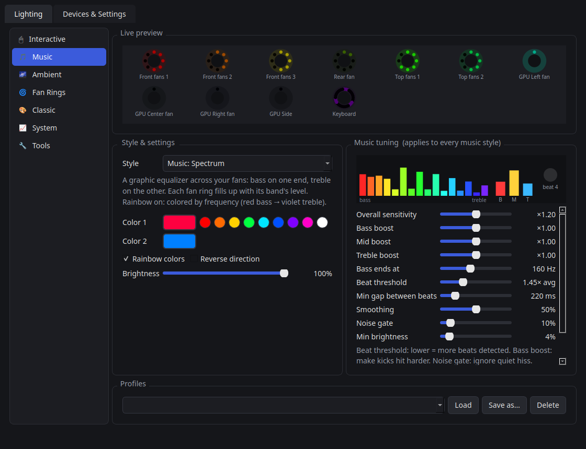
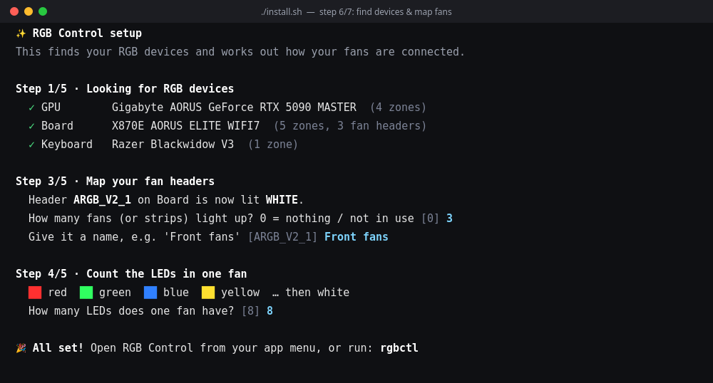
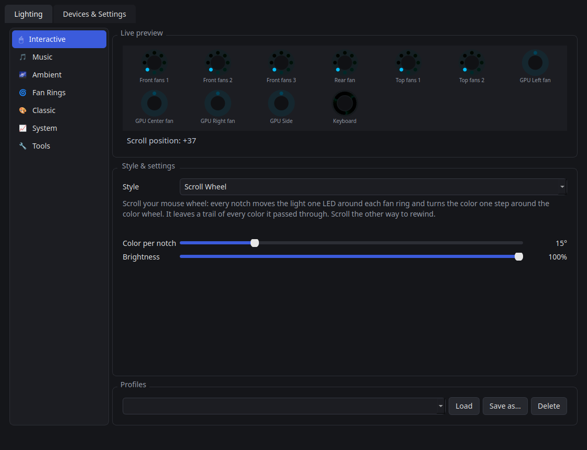
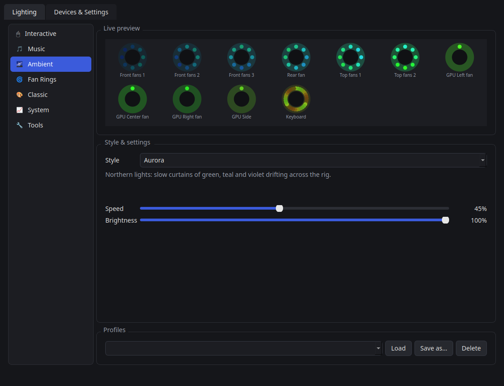
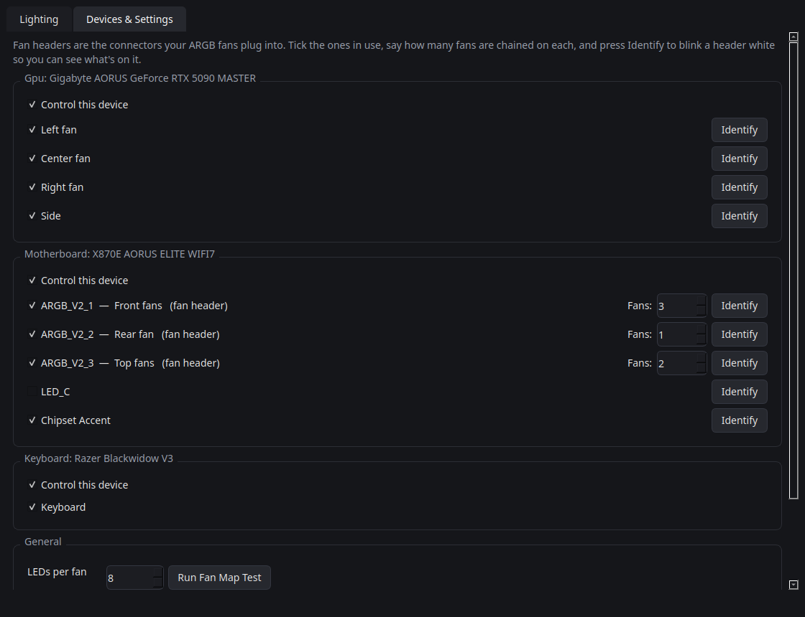

<div align="center">


# RGB Control

**Every fan. Every LED. In sync. On Linux.**

Control and synchronise the RGB lighting of your whole PC (case fans, GPU, motherboard,
RAM, keyboard and mouse) from one app, with 37 effects including music-reactive and
mouse/keyboard-interactive ones.

[**Website & live demo**](https://entangledquantum.github.io/linux-rgb-control/) ·
[**Download**](https://github.com/EntangledQuantum/linux-rgb-control/releases/latest) ·
[Install](#install) · [Effects](#modes--effects) · [Troubleshooting](#troubleshooting)



</div>

## Why

On Windows every brand ships its own lighting app, and they rarely agree with each other.
On Linux there's usually nothing. **RGB Control** sits on top of [OpenRGB](https://openrgb.org),
which talks to hundreds of devices, and drives *every* LED from a single clock. A rainbow
flows from your front fans through the GPU to your keyboard as one continuous wave.

## Features

- **True sync.** One render loop paints every LED on every device, every frame.
- **37 effects in 7 modes.** Pick a mode, then a style; each style only shows the settings it uses.
- **🎵 Music engine.** Captures what your PC is playing (no microphone), FFT into 16 bands,
  bass/mid/treble and beat detection, with deep tuning: per-band boost, bass cutoff, beat
  threshold, minimum beat gap, smoothing, noise gate. A live spectrum meter is built in.
- **🖱 Interactive.** Lights react to your scroll wheel, clicks, typing speed and pointer
  position, including a little *Catch the Firefly* game played on your fans.
- **Per-LED control.** Effects run around each fan's LED ring: spins, marquees, ring gauges.
- **📈 System-reactive.** CPU/GPU/RAM load gauges, a heartbeat that speeds up under load, temperature colors.
- **Guided setup.** The installer gets dependencies and OpenRGB, sets device permissions,
  finds your devices and *lights each fan header* so you can tell it what's plugged in.
- **Everyday stuff.** System tray, profiles, start at login, survives sleep/resume,
  plus a CLI for scripts and hotkeys.

## Install

```bash
git clone https://github.com/EntangledQuantum/linux-rgb-control.git
cd linux-rgb-control && ./install.sh
```

Or download the tarball from [Releases](https://github.com/EntangledQuantum/linux-rgb-control/releases/latest),
extract it, and run `./install.sh`.

The installer walks you through **7 steps** and tells you what it's doing at each one:

| Step | What happens |
|---|---|
| 1. System check | Detects your distro (apt, dnf, pacman or zypper) and offers to install anything missing: Python venv, `parec` for music, FUSE for AppImages |
| 2. Python environment | A private `.venv` with PySide6, openrgb-python, numpy and friends. Your system Python is untouched |
| 3. OpenRGB | Uses your installed OpenRGB, or downloads the official 1.1 AppImage and **verifies its SHA-256** |
| 4. Device permissions | *(sudo, asked once)* OpenRGB's udev rules plus I2C/SMBus access, so no root is needed afterwards |
| 5. App menu | Adds **RGB Control** to your app menu and a `rgbctl` command |
| 6. Setup wizard | Finds your devices, lights each fan header **white** and asks how many fans lit up, then counts the LEDs per fan with a color-block test |
| 7. Done | Optionally opens the app. Look for the rainbow-ring icon in your top bar |



Options: `./install.sh --yes` (no questions), `--no-system` (skip sudo steps), `--no-setup`,
`--uninstall`. You can re-run the wizard any time with `rgbctl setup`.

**Requirements:** Linux x86_64, Python 3.9+. Mouse/keyboard-reactive effects need an X11
session; everything else also works on Wayland.

## Modes & effects

| Mode | Styles |
|---|---|
| 🖱 **Interactive** | Catch the Firefly *(game)*, Scroll Wheel, Typing Sparks, Typing Speed Meter, Mouse Spotlight, Mouse Energy, Click Fireworks, Presence, Scroll Pong, Snake |
| 🎵 **Music** | Beat Party, Spectrum, Ripple, Pulse, plus one shared **Music tuning** panel |
| 🌌 **Ambient** | Firefly, Fire, Starlight, Raindrops, Lightning Storm, Aurora, Meteor Shower |
| 🌀 **Fan Rings** | Spin, Rainbow Ring, Marquee |
| 🎨 **Classic** | Static, Breathing, Color Cycle, Rainbow Wave, Gradient, Comet, Strobe, Police |
| 📈 **System** | System Monitor, Heartbeat, Temperature |
| 🔧 **Tools** | Fan Map Test, Off |

A few highlights:

- **Scroll Wheel**: every notch of your mouse wheel moves the light one LED around each
  fan ring and one step around the color wheel, leaving a trail of colors. Scroll back to rewind.
- **Catch the Firefly**: a 2–3 LED firefly hops between fans, your GPU and keyboard. Your
  mouse is the net (move left/right). Click when the net is on its fan, and don't hover too long.
- **Music: Spectrum**: each fan becomes an equalizer band and its LED ring fills with the level.
- **System Monitor**: case fans fill with CPU load, GPU fans with GPU load, the keyboard with RAM.

| Interactive | Ambient | Devices |
|---|---|---|
|  |  |  |

### Music tuning
| Setting | What it does |
|---|---|
| Overall sensitivity | Gain for everything |
| Bass / Mid / Treble boost | ×0.25 to ×4 per band, e.g. make kicks hit harder |
| Bass ends at | Where bass stops and mids begin (60–300 Hz) |
| Beat threshold | How big a bass jump counts as a beat (lower = more beats) |
| Min gap between beats | Stops double-triggers on busy tracks |
| Smoothing | Higher = calmer, slower fades |
| Noise gate | Ignore quiet hiss between songs |
| Min brightness | How dark it gets in silence |

## Command line

```bash
rgbctl                          # open the app (or bring it to front)
rgbctl set rainbow_wave --speed 60
rgbctl set static --color1 ff0000
rgbctl set music_beat --rainbow
rgbctl set temperature --temp-source gpu
rgbctl off
rgbctl profile "Night"          # a profile saved in the app
rgbctl effects                  # list all effect keys
rgbctl status
rgbctl setup                    # guided device setup
rgbctl --headless               # run with no window (e.g. as a service)
```
If the app is open, CLI changes apply instantly. If it isn't, `rgbctl` starts quietly in the background.

## Privacy

Interactive effects count scroll notches, clicks and keypresses and read the pointer
position. **Which keys you press is never read or stored.** Input capture only runs while
an interactive style is selected. Audio is analysed in memory and never recorded.
Nothing is sent anywhere: the app makes no network connections. The only download is
OpenRGB, during install.

## Hardware

Anything [OpenRGB supports](https://openrgb.org/devices.html) works: motherboards (ASUS,
Gigabyte, MSI, ASRock…), GPUs, RAM, Corsair/Razer/Logitech/SteelSeries peripherals,
LED controllers and more. Fan headers are detected automatically, and the wizard asks
what's plugged into each one.

Developed and tested on: Gigabyte X870E AORUS ELITE WIFI7 (ARGB headers), Gigabyte AORUS
RTX 5090 MASTER, Razer BlackWidow V3 + Basilisk V3, Ubuntu 24.04.

## Troubleshooting

<details><summary><b>My device isn't detected</b></summary>

- Log out and back in once after installing, so the I2C group membership applies.
- Motherboard or RAM RGB over SMBus may need the kernel parameter `acpi_enforce_resources=lax`.
- **Gigabyte boards:** if `lsusb | grep 048d` shows `57db ITE Upgrade Mode`, the RGB chip's
  firmware is stuck after a failed update. Reflash it once from Windows with Gigabyte's
  *"IT5711 RGB lighting controller firmware upgrade package"* from your board's support page.
  It should then show as `048d:5711`.
- Check the OpenRGB log: `~/.config/rgbctl/openrgb-server.log`.
</details>

<details><summary><b>Some fans on a header stay dark, or show two colors</b></summary>

Open **Devices & Settings**, press **Identify** next to the header, and set *Fans* to the
number that blinks. Then run **Tools → Fan Map Test**: each fan should be one solid color.
If a fan shows two colors, lower *LEDs per fan*. If part of the last fan is dark, raise it.
</details>

<details><summary><b>Music effects don't react</b></summary>

They listen to your default output (`parec --device=@DEFAULT_MONITOR@`). Make sure audio
plays through the default device and `parec` is installed (`pulseaudio-utils`). Watch the
meter in *Music tuning*, and raise *Overall sensitivity* or lower *Beat threshold*.
</details>

<details><summary><b>Mouse/keyboard effects say "input capture unavailable"</b></summary>

They need an X11 session. On Wayland, pick "Ubuntu on Xorg" (or similar) at the login screen.
</details>

<details><summary><b>Lights flicker or fight each other</b></summary>

Only one program should drive the lights. Close the OpenRGB window, SignalRGB or vendor
tools while RGB Control is running.
</details>

## How it works

```
your devices ←USB HID / I2C→ OpenRGB server (127.0.0.1:6742) ←SDK→ rgbctl engine ← GUI / tray / CLI
                                                                       ↑
                                               effects · audio FFT · input · CPU/GPU stats
```

- `rgbctl/engine.py` is the render loop (30 FPS by default): effect → per-LED colors → one
  update per device, with throttling for slow I2C devices and recovery after sleep.
- `rgbctl/backend.py` handles OpenRGB server management and builds the LED layout (each
  LED's position along the rig and around its fan ring).
- `rgbctl/effects.py`, `rgbctl/effects_fun.py`: the effects.
- `rgbctl/sensors.py`: audio analysis, input counting, temperatures and load.
- Settings live in `~/.config/rgbctl/` (`state.json`, `profiles/`).

Regenerate the screenshots after UI changes:
`QT_QPA_PLATFORM=offscreen .venv/bin/python tools/screenshots.py docs/screenshots`

## Uninstall

```bash
./install.sh --uninstall
```

## Credits

Built on [OpenRGB](https://openrgb.org) and [openrgb-python](https://github.com/jath03/openrgb-python).
Licensed under the [MIT License](LICENSE).
